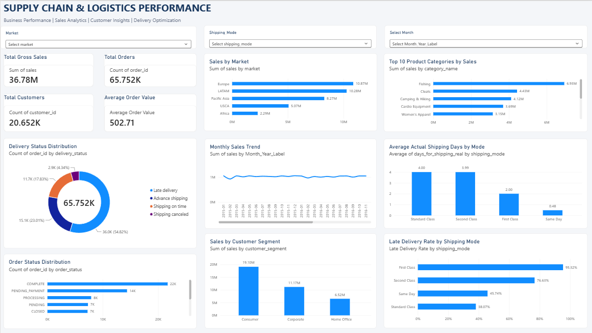
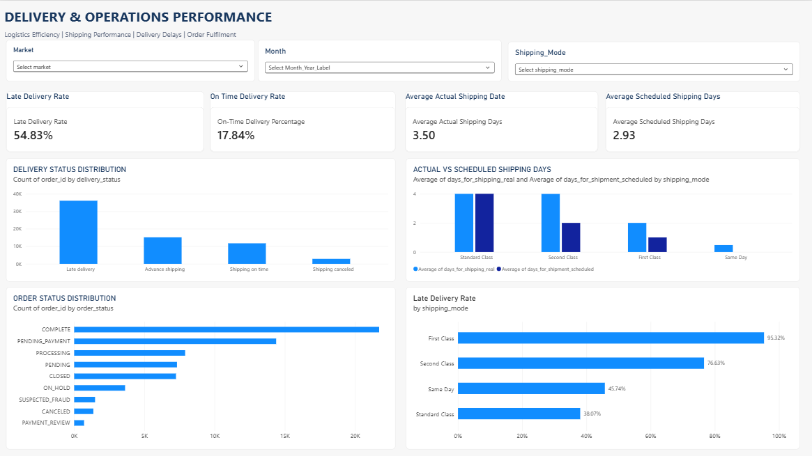
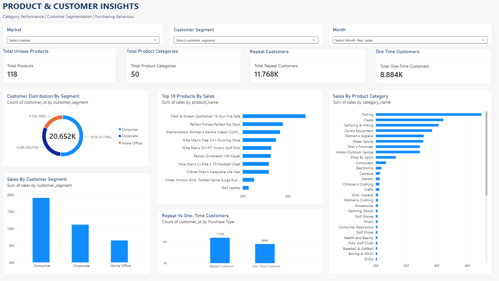

# Supply Chain & Logistics Performance Analytics

## Project Overview

This project analyzes supply chain and logistics operations using Python, MySQL, and Power BI. It focuses on sales performance, delivery efficiency, shipping operations, product performance, and customer purchasing behaviour.

The objective is to transform raw supply chain data into meaningful business insights through data cleaning, exploratory analysis, SQL queries, and interactive Power BI dashboards.

## Tools & Technologies

- **Python:** Pandas, NumPy, Matplotlib, Seaborn, SciPy, Scikit-learn
- **Database:** MySQL
- **Data Visualization:** Power BI
- **Development Environment:** VS Code, Jupyter Notebook
- **Version Control:** Git and GitHub

## Dataset

- Dataset: DataCo Smart Supply Chain Dataset
- Source: [Kaggle – DataCo Smart Supply Chain](https://www.kaggle.com/datasets/shashwatwork/dataco-smart-supply-chain-for-big-data-analysis)
- Original records: 180,519
- Cleaned records: 180,519
- Cleaned columns: 43

## Project Workflow

### 1. Data Auditing and Cleaning
- Inspected dataset dimensions, data types, missing values, and duplicates.
- Identified irrelevant and highly incomplete columns.
- Standardized column names.
- Removed unnecessary columns and handled missing values.
- Generated a cleaned dataset containing 180,519 records and 43 columns.

### 2. Exploratory Data Analysis
- Analyzed sales trends over time.
- Evaluated market-wise and category-wise performance.
- Examined delivery status and shipping performance.
- Investigated customer segments and purchasing behaviour.
- Generated analytical reports and visualizations.

### 3. SQL Analysis
Performed business analysis using MySQL, including:
- Overall business performance
- Sales by market and product category
- Shipping and delivery performance
- Customer segmentation and repeat purchases
- Order status distribution
- Shipping delays and delivery time
- Financial and revenue validation

### 4. Power BI Dashboards

**Page 1: Executive Overview**
- Overall business KPIs
- Monthly sales trends
- Sales by market
- Top product categories
- Customer segment performance
- Delivery status distribution

**Page 2: Delivery & Operations Analysis**
- Late delivery percentage
- On-time delivery percentage
- Actual versus scheduled shipping days
- Late delivery rates by shipping mode
- Order status distribution

**Page 3: Product & Customer Insights**
- Total products and product categories
- Repeat and one-time customers
- Sales by product category
- Top 10 products by sales
- Customer segment distribution

All three pages include interactive filters.

## Key Business Insights

- Total gross item sales were approximately 36.78 million dataset currency units.
- The dataset contains 65,752 distinct orders and 20,652 distinct customers.
- Consumer customers generated the highest sales, approximately 19.10 million.
- Europe recorded the highest market-wise sales, approximately 10.87 million.
- Fishing was the highest-selling product category by gross sales.
- Approximately 57% of customers were repeat customers.
- First Class shipping had the highest late-delivery rate among shipping modes.

## Important Analytical Considerations

- The dataset contains order-item-level records, not one row per unique order.
- Gross sales and net item sales are treated separately.
- The dataset does not specify its currency; therefore, monetary values are not assigned a currency symbol.
- The late delivery risk field duplicates the actual late-delivery outcome and is not treated as an independent predictive feature.
- Lower record coverage in the later months is considered when interpreting monthly trends.
- Profit-related fields require caution because their values are inconsistent across items within many orders.

## Project Structure

```text
Supply Chain And Inventory Analytics/
│
├── data/
│   ├── raw/
│   └── processed/
│
├── notebooks/
│
├── sql/
│
├── powerbi/
│
├── reports/
│   └── figures/
│
├── screenshots/
│
├── README.md
├── requirements.txt
└── .gitignore
```
## Power BI Dashboard Previews

### 1. Executive Overview


### 2. Delivery & Operations Analysis


### 3. Product & Customer Insights


## Conclusion

This project demonstrates an end-to-end analytics workflow, combining Python-based data preparation, SQL-driven business analysis, and interactive Power BI reporting to evaluate supply chain and logistics performance.
